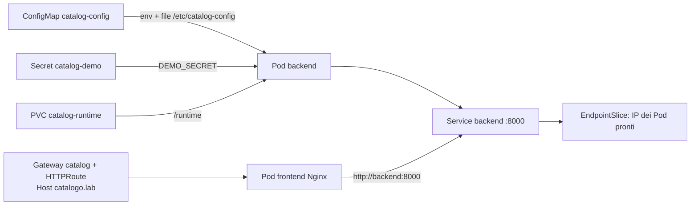

# UD16 — Inventario dei concetti e prerequisiti

ConfigMap, Secret, PV, PVC, Service e Gateway rispondono a bisogni diversi: la **ConfigMap** distribuisce configurazione non sensibile, il **Secret** trasporta dati che non devono essere pubblici, il **PV** è la risorsa di storage reale, il **PVC** è la richiesta di storage che un Pod può montare, il **Service** dà un indirizzo stabile e un nome DNS a un insieme di Pod, il **Gateway** espone il traffico HTTP verso le applicazioni tramite un controller.

## Oggetti e relazioni

1. **ConfigMap e Secret**: la ConfigMap contiene valori non riservati (soglia, porta, directory); il Secret contiene dati che non devono finire in chiaro nel repository o in una ConfigMap. Nei manifest il Secret usa spesso Base64, che è una codifica reversibile e **non una cifratura**: la protezione vera dipende da RBAC, gestione delle credenziali e cifratura dello storage del cluster. In questo laboratorio `catalog-demo` è un dato fittizio, non una password.

2. **ConfigMap come file o come variabile**: come variabile d'ambiente le chiavi diventano variabili lette dal processo all'avvio; se il valore cambia, il processo già avviato non lo rilegge da solo. Come file montato le chiavi diventano file in una directory e Kubernetes può aggiornarli nel tempo; l'applicazione deve però rileggerli esplicitamente. Il backend usa entrambi i modi: `envFrom` per le variabili e un volume `config-file` in `/etc/catalog-config` in sola lettura.

3. **PVC e StorageClass**: il PVC è la richiesta di storage (capacità, modalità di accesso) e viene associato a un PV. La StorageClass descrive **come** creare quel volume: provisioner e parametri. Con `standard` (`k8s.io/minikube-hostpath`) il volume viene creato dinamicamente quando nasce il PVC; senza una StorageClass utilizzabile il PVC resterebbe `Pending`.

4. **Service, selector, label ed EndpointSlice**: i Pod hanno label (`app=backend`), il Service ha un selector che sceglie i Pod con quelle label. Il Service fornisce IP virtuale e nome DNS stabili; gli EndpointSlice contengono gli IP dei Pod selezionati e pronti. Se il selector non corrisponde a nessuna label, il Service esiste ma non ha endpoint e le richieste falliscono.

5. **GatewayClass, Gateway, HTTPRoute e controller**: la GatewayClass dichiara l'implementazione del controller (nel laboratorio Nginx Gateway Fabric); il Gateway definisce i listener (porta, protocollo, hostname) ed è istanziato dal controller; l'HTTPRoute contiene le regole di instradamento (host e path) verso un Service; il controller riconcilia questi oggetti e configura il proxy che riceve il traffico. Il solo manifest del Gateway non basta senza un controller operativo.

## Prerequisiti osservati

Postazione: Linux Fedora con Docker 29.9.3 e Docker Compose v5.7.0, terminale unico su Minikube.

```text
Context kubectl: minikube
Minikube: profilo minikube Running
Nodo: minikube Ready, v1.37.0
UD15: deployment web-intro 1/1 nel namespace ft152-ud15
StorageClass: standard (default, k8s.io/minikube-hostpath)
CoreDNS: deployment coredns 1/1 in kube-system
Namespace UD16: ft152-catalogo creato nel guidato
Helm: v4.2.2 presente
CRD Gateway API: assenti all'inizio, installate nel guidato (profilo standard v2.7.2)
GatewayClass: nessuna all'inizio; `nginx` Accepted=True dopo il guidato
Porta 18016: libera all'inizio; ingresso Compose attivo dopo il guidato
Stato finale: soglia 5, backend/frontend 1/1, PVC Bound, Gateway Programmed=True
```

## Schema o esempio significativo



L'esempio mostra il confine fra configurazione, dato persistente e rete: la ConfigMap e il Secret cambiano il comportamento del processo, il PVC conserva il contatore, il Service e gli EndpointSlice collegano i Pod, il Gateway pubblica il percorso HTTP.
